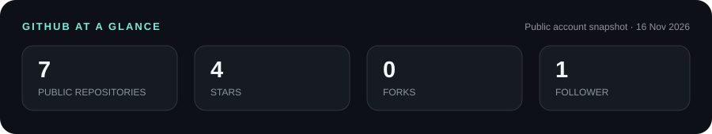

  

<h1 align="center">Hey, I'm Aditya Lashkari</h1>

  Developer from India building practical AI projects, desktop tools, and web experiences.

  
  
  
  

  

## About me

I enjoy turning useful ideas into clear, approachable software. My recent work spans applied machine learning for agriculture, animated Windows desktop companions, and web applications.

## Selected projects

<table>
  <tr>
    <td width="50%">
      <h3><a href="https://github.com/LashkariAditya/TaskBar-Pets">TaskBar Pets</a></h3>
      
Animated desktop companions for Windows, with interactive features and a large collection of customizable pets.

      Python · Windows
    </td>
    <td width="50%">
      <h3><a href="https://github.com/LashkariAditya/Crop-Advisor">Crop Advisor</a></h3>
      
An India-focused crop-planning prototype with crop suitability, soil and weather context, rotation ideas, and farm-budget estimates.

      Python · JavaScript · Machine learning
    </td>
  </tr>
  <tr>
    <td width="50%">
      <h3><a href="https://github.com/LashkariAditya/Aura.">Aura</a></h3>
      
A music web application project.

      JavaScript · Web
    </td>
    <td width="50%">
      <h3><a href="https://github.com/LashkariAditya/AI-Codes">AI Codes</a></h3>
      
Python exercises and implementations of classic algorithms and problem-solving examples.

      Python
    </td>
  </tr>
</table>

More projects: [Crop Recommendation](https://github.com/LashkariAditya/Crop-Recomandation) · [Rajbai](https://github.com/LashkariAditya/rajbai) · [all repositories](https://github.com/LashkariAditya?tab=repositories)

## GitHub stats

  

  

## Language breakdown

  

## Contribution activity

  

## Connect with me

  <a href="https://github.com/LashkariAditya">GitHub</a> ·
  <a href="https://www.instagram.com/_aditya_lashkari/">Instagram</a>

---

Always learning. Always building.

