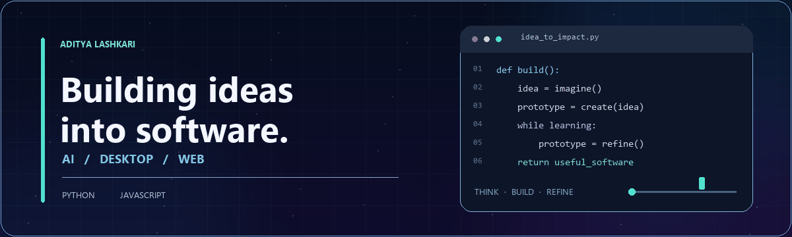
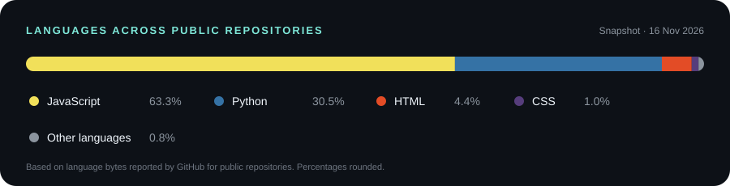

  

<h1 align="center">Hi, I'm Aditya Lashkari</h1>

  I build practical AI projects, desktop tools, and web experiences.

  
  
  

## What I build

<table>
  <tr>
    <td align="center" width="33%">
      <h3>Applied AI</h3>
      
Machine learning ideas shaped into practical prototypes, including agriculture and crop planning.

    </td>
    <td align="center" width="33%">
      <h3>Desktop tools</h3>
      
Playful Windows utilities with thoughtful interactions and customization.

    </td>
    <td align="center" width="33%">
      <h3>Web experiences</h3>
      
Useful product and music projects built for the browser.

    </td>
  </tr>
</table>

## Tech I use

  
  
  
  

## Featured projects

<table>
  <tr>
    <td width="50%">
      <h3><a href="https://github.com/LashkariAditya/TaskBar-Pets">🐾 TaskBar Pets</a></h3>
      
Animated companions for Windows, with interactive features and a large collection of customizable pets.

      
      Python · Windows
    </td>
    <td width="50%">
      <h3><a href="https://github.com/LashkariAditya/Crop-Advisor">🌱 Crop Advisor</a></h3>
      
An India-focused crop-planning prototype with suitability, soil and weather context, rotation ideas, and farm-budget estimates.

      
      Python · JavaScript · Machine learning
    </td>
  </tr>
  <tr>
    <td width="50%">
      <h3><a href="https://github.com/LashkariAditya/Aura.">🎧 Aura</a></h3>
      
A music web application project.

      <a href="https://aura-music-67.vercel.app/">Live demo</a> ·
      
      JavaScript · Web
    </td>
    <td width="50%">
      <h3><a href="https://github.com/LashkariAditya/AI-Codes">🧠 AI Codes</a></h3>
      
Python exercises and implementations of classic algorithms and problem-solving examples.

      
      Python
    </td>
  </tr>
</table>

  <a href="https://github.com/LashkariAditya?tab=repositories">Explore all my repositories →</a>

## GitHub at a glance

  

  

## Contribution activity

  

  

---

Always learning. Always building.

